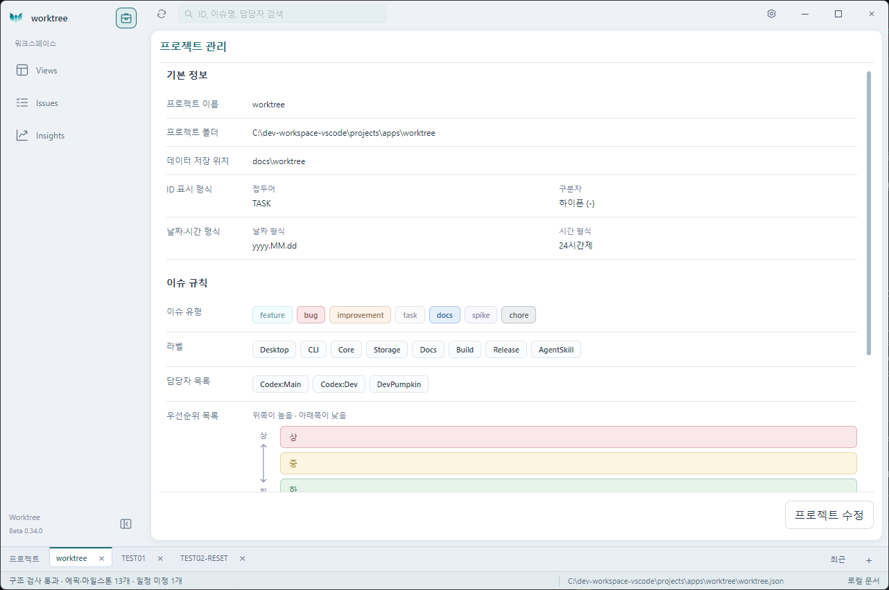
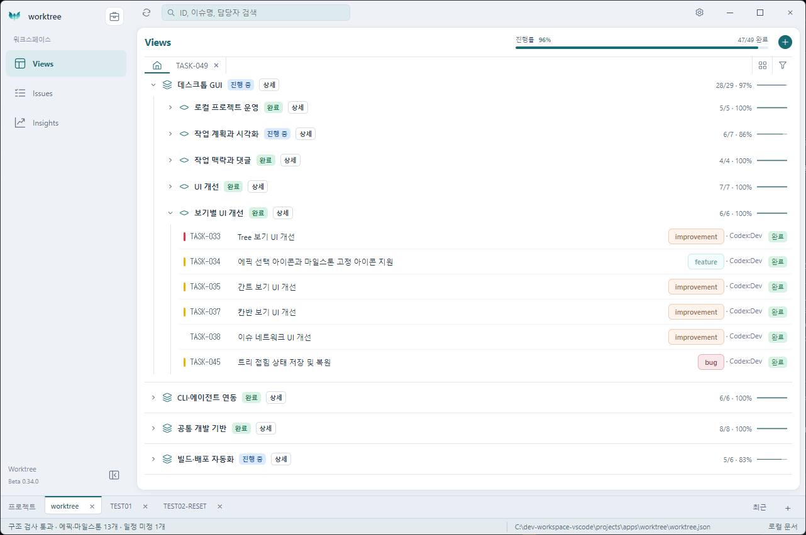
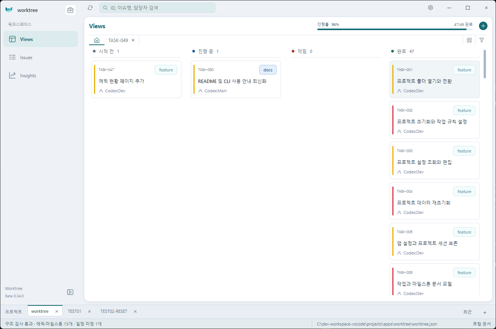
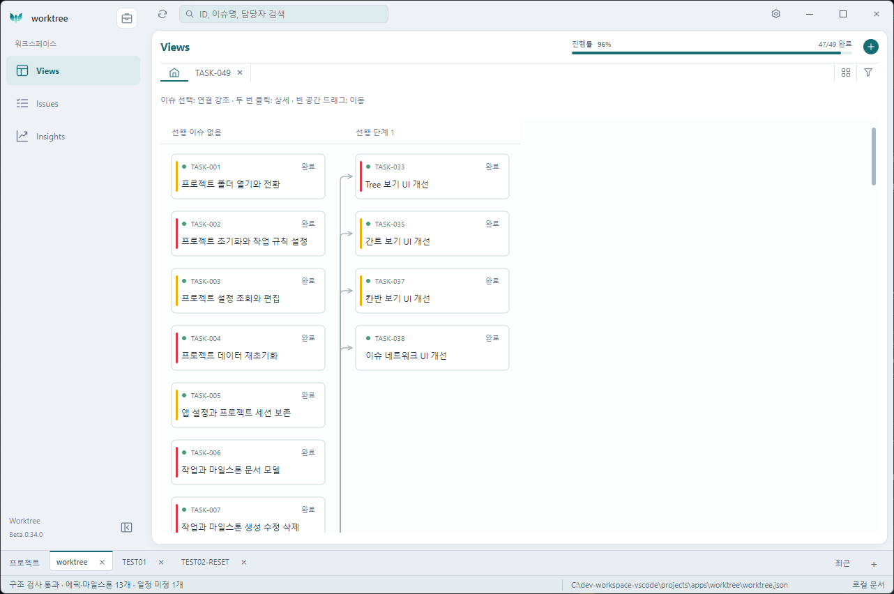
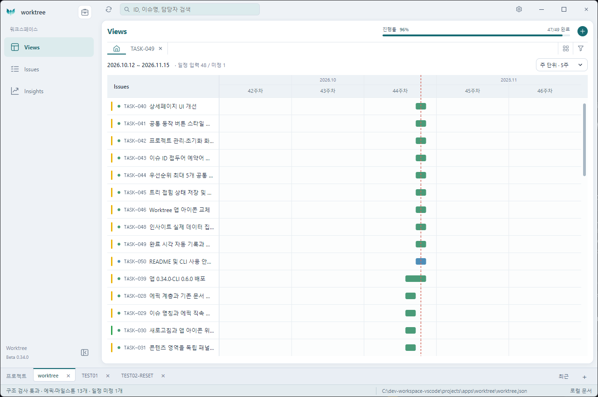
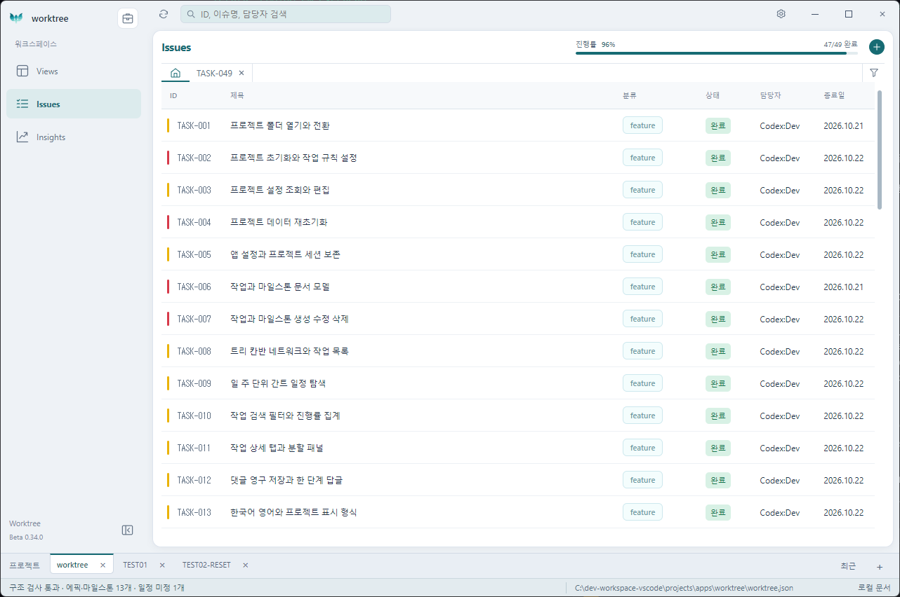
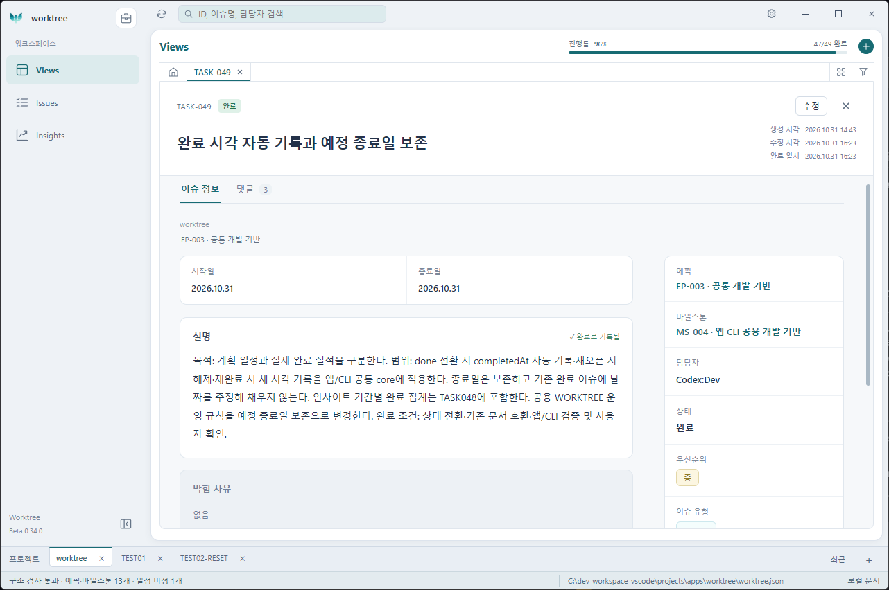
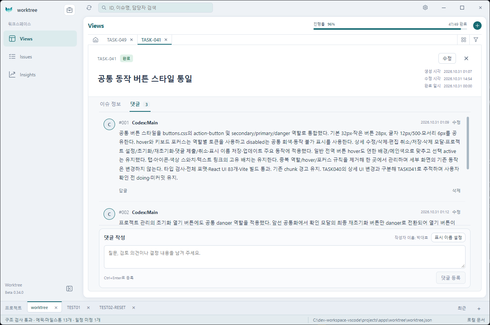
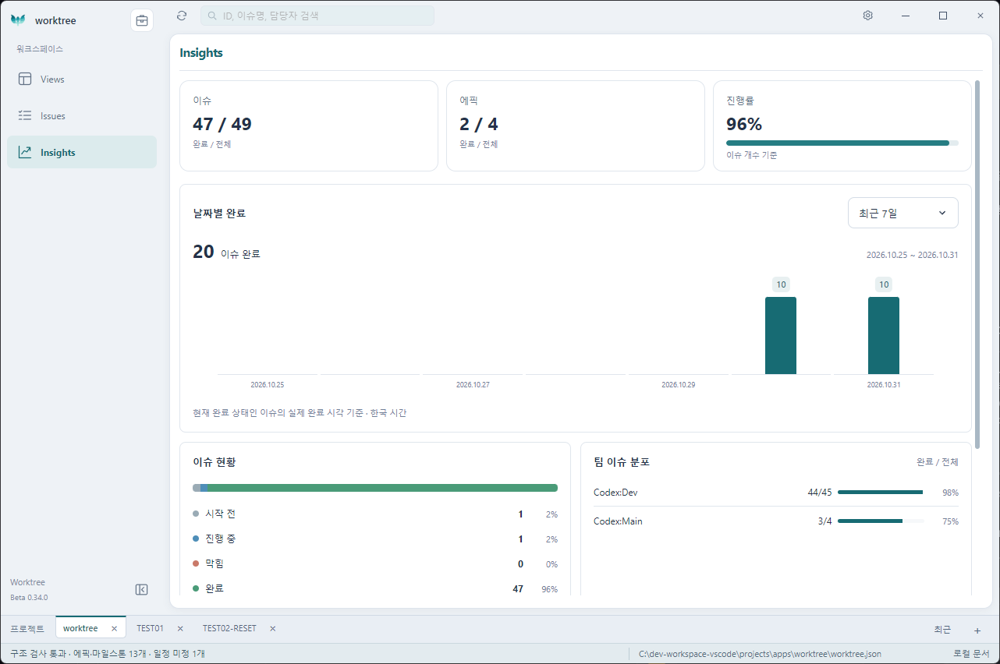

[EN](https://github.com/DevPumpkin0113/worktree/blob/main/README.md) | [KO](https://github.com/DevPumpkin0113/worktree/blob/main/README.ko.md)

<div align="center">
  
  <h1>Worktree</h1>
  <p>A Windows desktop app and CLI for tasks and schedules</p>
  <p><strong>Beta Worktree 0.36.0</strong></p>
  <a href="https://github.com/DevPumpkin0113/worktree/releases">
    
  </a>
</div>

---

## Features

- **Multiple views** — Tree, Kanban, dependency network, Gantt chart, and task list.
- **Issue hierarchy** — Organize work as epic → milestone → issue, or assign issues directly to an epic.
- **Epic overview** — Compare epic goals, progress, schedules, and blocked issues; review milestones and direct issues.
- **Schedules and dependencies** — Manage dates, estimated work hours, predecessors, and successors.
- **Organization and search** — Organize tasks by assignee, status, priority, type, and labels; search and filter the results.
- **Task details** — Open multiple tasks in tabs or use a side panel alongside the list.
- **Insights** — Compare issue statuses, assignee progress, and epic completion. View daily completions for the last 7 days, 30 days, or a custom period of up to 366 days, using Korea time.
- **Comments and replies** — Discuss tasks using your configured display name.
- **Project management** — Switch between project tabs and configure rules for each project.
- **Local files** — Keep data in your project folder and refresh external changes.
- **CLI** — Manage epics, milestones, issues, and comments from a terminal or interactive console. [CLI guide](apps/cli/README.md)
- **Languages** — English and Korean.

## CLI

Use the same project files from a terminal. Windows x64 and Node.js 24 or later are required.

```powershell
npm install --global @devpumpkin0113/worktree-cli
cd C:\projects\example
worktree init
worktree shell
```

The CLI supports epics, milestones, issues, comments, filters, batch changes, conflict checks, and recovery. Skip init for an existing desktop project. [English CLI guide](apps/cli/README.md) · [한국어 CLI 안내](apps/cli/README.ko.md)

## Agent skill

Use the [Worktree CLI skill](skills/worktree-cli/SKILL.md) to let an AI agent manage tasks through the CLI. Install the CLI separately as shown above.

```powershell
npx skills add DevPumpkin0113/worktree --skill worktree-cli -g
```

Select your coding agent when prompted. `-g` installs for your user across projects.

## Files in your project

Initialization creates a root `worktree.json` and a data directory. The default is `docs/worktree`; you can choose a different relative directory during setup.

```text
project/
├─ worktree.json                 # Data directory location
└─ docs/
   └─ worktree/
      ├─ project.json            # Project settings and rules
      ├─ epics/
      │  └─ EP001.md             # One file per epic
      ├─ tasks/
      │  └─ W001.md              # One file per task
      ├─ milestones/
      │  └─ MS001.md             # One file per milestone
      └─ comments/
         └─ W001/
            └─ <UUID>.md         # One file per comment on this task
```

The issue prefix, `W` in this example, is chosen during initialization. Epics use `EP`, milestones use `MS`, and each item has its own file. Renaming or moving an item preserves its ID and filename. Empty directories may be created when their first item is added.

New issue prefixes cannot be `EP` or `MS`, and projects support up to five priorities, excluding Unassigned. Existing `EP`-prefix projects remain supported. App deletion removes only the selected item and keeps its children; deleting a milestone moves its issues to the parent epic or No epic. Removing links from successor issues requires explicit consent. CLI cascade deletion remains an explicit option.

Files are text-based, so you can inspect them and track them with Git.

## Screenshots

Screenshots use Worktree development tasks as example data.

### Project management

Review and edit project settings and task rules.

<div align="center">
  
</div>

### View · Tree

Browse epics, milestones, and direct issues in a hierarchy and track progress.

<div align="center">
  
</div>

### View · Kanban

Follow the workflow with tasks grouped by status.

<div align="center">
  
</div>

### View · Dependency network

Explore predecessor and successor relationships.

<div align="center">
  
</div>

### View · Gantt chart

Review task schedules and durations.

<div align="center">
  
</div>

### Issues

Inspect all tasks in a table and use search and filters.

<div align="center">
  
</div>

### Task details

Review and edit dates, descriptions, assignees, priorities, and dependencies.

Descriptions support Markdown headings, lists, checklists, tables, and code blocks.

Name references, open web links and project-local files/folders, or copy their paths.

<div align="center">
  
</div>

### Comments and replies

Discuss each task and identify reply targets by comment number.

<div align="center">
  
</div>

### Insights

Insights shows issue and epic completion totals, status distribution, assignee progress, and epic progress, including issues with no epic. Daily completions are calculated from actual completion timestamps.

<div align="center">
  
</div>

## Getting started

1. Open a folder for your project.
2. Set project information and task rules.
3. Add epics, milestones, and issues. Issues can belong directly to an epic or remain unassigned.

Use the download button for published desktop installers.

Account login and server-based real-time collaboration are not currently available.

## Report an issue

Report bugs and suggestions through [GitHub Issues](https://github.com/DevPumpkin0113/worktree/issues). You can also open the issue form from **App information** in the app settings.

Include your version, reproduction steps, and error message. Remove personal information and sensitive project content from screenshots.

## References

- [Backlog.md](https://github.com/MrLesk/Backlog.md)
- [Linear](https://linear.app/features)
