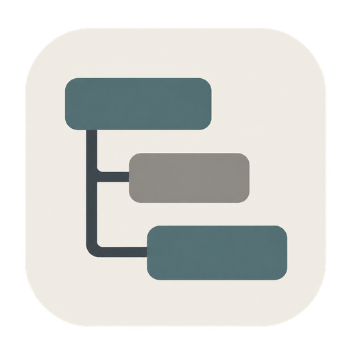

[EN](https://github.com/DevPumpkin0113/worktree/blob/main/README.md) | [KO](https://github.com/DevPumpkin0113/worktree/blob/main/README.ko.md)

<div align="center">
  
  <h1>Worktree</h1>
  <p>A Windows desktop app and CLI for tasks and schedules</p>
  <p><strong>Beta Worktree 0.33.2</strong></p>
  <a href="https://github.com/DevPumpkin0113/worktree/releases">
    
  </a>
</div>

---

## Features

- **Multiple views** — Tree, Kanban, dependency network, Gantt chart, and task list.
- **Task management** — Create, edit, and delete tasks and milestones, and track progress.
- **Schedules and dependencies** — Manage dates, estimated work hours, predecessors, and successors.
- **Organization and search** — Organize tasks by assignee, status, priority, type, and labels; search and filter the results.
- **Task details** — Open multiple tasks in tabs or use a side panel alongside the list.
- **Comments and replies** — Discuss tasks using your configured display name.
- **Project management** — Switch between project tabs and configure rules for each project.
- **Local files** — Keep data in your project folder and refresh external changes.
- **CLI** — Manage tasks, milestones, and comments from a terminal or interactive console. [CLI guide](apps/cli/README.md)
- **Languages** — English and Korean.

## CLI

Use the same project files from a terminal. Windows x64 and Node.js 24 or later are required.

```powershell
npm install --global @devpumpkin0113/worktree-cli
cd C:\projects\example
worktree init
worktree shell
```

The CLI supports tasks, milestones, comments, filters, batch changes, conflict checks, and recovery. Skip init for an existing desktop project. [English CLI guide](apps/cli/README.md) · [한국어 CLI 안내](apps/cli/README.ko.md)

## Agent skill

Use the [Worktree CLI skill](skills/worktree-cli/SKILL.md) to let an AI agent manage tasks through the CLI. Install the CLI separately as shown above.

```powershell
npx skills add DevPumpkin0113/worktree --skill worktree-cli -g
```

Select your coding agent when prompted. `-g` installs for your user across projects.

## Files in your project

Initialization creates a root `worktree.json` and a data directory. The default is `docs/worktree`; you can choose a different relative directory during setup.

```text
project/
├─ worktree.json                 # Data directory location
└─ docs/
   └─ worktree/
      ├─ project.json            # Project settings and rules
      ├─ tasks/
      │  └─ W001.md              # One file per task
      ├─ milestones/
      │  └─ MS001.md             # One file per milestone
      └─ comments/
         └─ W001/
            └─ <UUID>.md         # One file per comment on this task
```

The task prefix, `W` in this example, is chosen during initialization. Tasks, milestones, and comments have separate files. Renaming a title preserves the ID and filename. Empty directories may be created when their first item is added.

Files are text-based, so you can inspect them and track them with Git.

## Screenshots

These examples use Worktree development tasks. Dates and statuses are demonstration data.

### Project management

Review and edit project settings and task rules.

<div align="center">
  
</div>

### Task board · Tree

Group tasks by milestone and track progress.

<div align="center">
  
</div>

### Task board · Kanban

Follow the workflow with tasks grouped by status.

<div align="center">
  
</div>

### Task board · Dependency network

Explore predecessor and successor relationships.

<div align="center">
  
</div>

### Task board · Gantt chart

Review task schedules and durations.

<div align="center">
  
</div>

### Task list

Inspect all tasks in a table and use search and filters.

<div align="center">
  
</div>

### Task details

Review and edit dates, descriptions, assignees, priorities, and dependencies.

<div align="center">
  
</div>

### Comments and replies

Discuss each task and identify reply targets by comment number.

<div align="center">
  
</div>

### Insights

**Further development required** — Project analytics are still in development.

<div align="center">
  
</div>

## Getting started

1. Open a folder for your project.
2. Set project information and task rules.
3. Add milestones and tasks to manage your schedule.

Use the download button for published desktop installers.

Account login and server-based real-time collaboration are not currently available.

## Report an issue

Report bugs and suggestions through [GitHub Issues](https://github.com/DevPumpkin0113/worktree/issues). You can also open the issue form from **App information** in the app settings.

Include your version, reproduction steps, and error message. Remove personal information and sensitive project content from screenshots.

## References and related projects

Backlog.md was consulted while exploring document-based task management and human–AI collaboration. Linear is included as a related project-management service for comparison.

- [Backlog.md](https://github.com/MrLesk/Backlog.md) — Markdown-based task management for people and AI agents.
- [Linear](https://linear.app/features) — A collaborative product-development service for issue tracking, project planning, and cycles.
